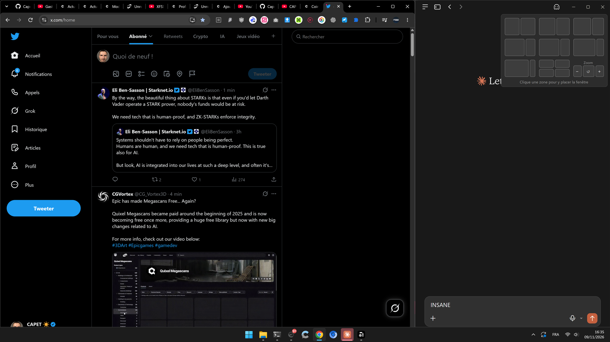
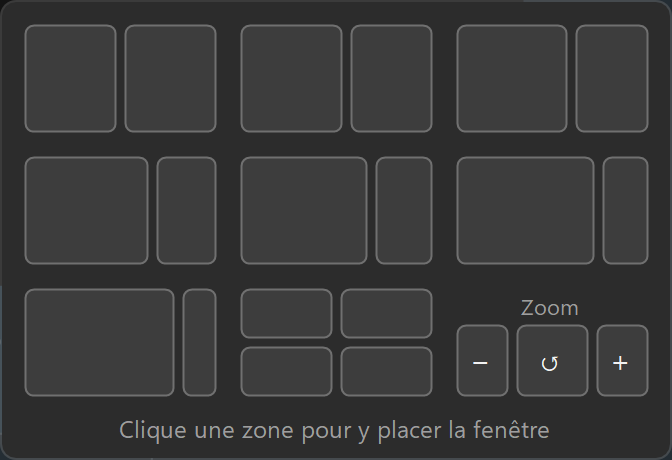

# CustomFancyZone

[English](README.md) · **Français**

Tes propres dispositions d'ancrage sous Windows 11. Survole le bouton **Agrandir** (□) de n'importe quelle
fenêtre et choisis une zone, comme avec le menu Snap Layouts de Windows, mais avec **les dispositions que tu
veux** : 55/45, 60/40, 74/26, ce que tu veux.



<p align="center"></p>

## Fonctionnalités

- **Dispositions perso au survol.** Le menu s'ouvre sous le bouton Agrandir après 0,4 s, comme celui de Windows.
- **8 dispositions fournies :** 50/50, 55/45, 60/40, 2/3 + 1/3, 68/32, 74/26, 80/20 et quatre quarts.
  Elles se modifient dans un petit fichier `layouts.json`, relu dès l'enregistrement.
- **Assistance d'ancrage, comme Windows.** Une fois une fenêtre placée, les zones vides affichent les miniatures
  en direct de tes autres fenêtres : un clic remplit chaque zone.
- **Plus de fenêtres coupées.** Certaines applis ne descendent pas sous une largeur minimale (Claude, Discord…).
  Au lieu de déborder de l'écran, elles sont recalées contre le bord et la fenêtre voisine prend le reste.
- **Zoom** (− · ↺ · +) directement dans le menu, et zoom automatique par zone en option.
- **Marche avec les barres de titre personnalisées :** Chrome, Edge, applis Electron, Bloc-notes de Windows 11,
  et Unreal Engine.
- Aperçu de la zone sur l'écran, thème clair/sombre et couleur d'accentuation, plusieurs écrans avec des mises
  à l'échelle différentes.
- Aucun pilote, aucun service, aucun droit administrateur, 0 % de CPU au repos.

## Installation

Windows 10 (1809+) ou Windows 11, 64 bits. Rien d'autre à installer : .NET est inclus.

👉 **[Télécharger la dernière version](https://github.com/Capetlevrai/windows-custom-snap-layout/releases/latest)**

| Fichier | Rôle |
|---|---|
| `CustomFancyZone-Setup-x.y.z.exe` | **Recommandé.** Installation pour ton compte, sans droits administrateur. Raccourci dans le menu Démarrer et option « Lancer au démarrage de Windows ». Désinstallation depuis *Paramètres > Applications*. |
| `CustomFancyZone.exe` | Version portable : à poser où tu veux et à lancer. `layouts.json` est créé à côté. |

Les exe ne sont pas signés : si Windows SmartScreen affiche « Windows a protégé votre ordinateur »,
clique *Informations complémentaires > Exécuter quand même*.

## Démarrage rapide

1. **Lance CustomFancyZone.** Une icône apparaît dans la zone de notification (à côté de l'horloge, parfois
   derrière la flèche ^).
2. **Coupe le menu de Windows**, sinon les deux menus se superposent :
   *Paramètres > Système > Multitâche > Ancrer les fenêtres* (déplier), puis décoche
   « Afficher les dispositions d'ancrage lorsque je survole le bouton permettant de développer une fenêtre ».
   L'outil te le rappelle au démarrage ; un clic sur la notification ouvre la bonne page.
3. **Survole** le bouton Agrandir d'une fenêtre pendant 0,4 s et **clique une zone**.
4. **Choisis** la fenêtre qui va à côté dans la zone vide (ou Échap).

## Utilisation

| Geste | Effet |
|---|---|
| Survol de □ pendant 0,4 s | Ouvre le menu sous le bouton (au-dessus s'il n'y a pas la place). |
| Survol d'une zone | La zone s'allume, un rectangle translucide montre où ira la fenêtre, le nom de la disposition s'affiche en bas. |
| Clic sur une zone | La fenêtre remplit la zone (une fenêtre agrandie est d'abord restaurée). |
| Assistance d'ancrage | Chaque zone restante affiche les miniatures de tes autres fenêtres, les plus récentes d'abord. Un clic en place une ; Échap ou un clic ailleurs arrête. |
| Zoom − · ↺ · + | Envoie Ctrl − / Ctrl 0 / Ctrl + à la fenêtre survolée. Le menu reste ouvert pour enchaîner les crans. |
| Clic sur □ lui-même | Agrandit normalement et ferme le menu. |

Clic droit sur l'icône : modifier les dispositions, ouvrir le dossier, recharger, état du menu de Windows,
lancer avec Windows, pause et quitter.

## Personnaliser

Tout se trouve dans `layouts.json`, à côté de l'exe (`%LOCALAPPDATA%\Programs\CustomFancyZone\` avec
l'installeur ; le menu de l'icône l'ouvre directement). Les commentaires `//` sont acceptés. En cas d'erreur, une
notification l'explique et la configuration précédente reste active. Supprime le fichier pour retrouver les
réglages d'origine.

### Dispositions

Une disposition est soit une **`grid`** dessinée avec des lettres (une lettre = une zone, toutes les colonnes ont
la même largeur, `.` = case vide), soit une liste de **`zones`** `[x, y, largeur, hauteur]` en % de l'écran
(hors barre des tâches).

```jsonc
{ "name": "50 / 50",               "grid": ["AB"] }
{ "name": "2/3 | 1/3",             "grid": ["AAB"] }
{ "name": "Quatre quarts",         "grid": ["AB", "CD"] }
{ "name": "Moitié + deux empilées", "grid": ["AB", "AC"] }               // A sur les deux lignes
{ "name": "55 / 45",               "zones": [[0, 0, 55, 100], [55, 0, 45, 100]] }
{ "name": "Centrée",               "zones": [[20, 5, 60, 90]] }
```

Les zones sont numérotées dans l'ordre de lecture des lettres (`grid`) ou de la liste (`zones`) ; l'assistance
les remplit dans cet ordre.

L'option **`zoom`** donne un zoom en % pour la fenêtre placée dans chaque zone (`null` = ne pas toucher) :

```jsonc
{ "name": "74 / 26", "zones": [[0, 0, 74, 100], [74, 0, 26, 100]], "zoom": [null, 80] }
```

### Options

| Option | Défaut | Rôle |
|---|---|---|
| `hoverDelayMs` | `400` | Temps de survol du bouton avant l'ouverture du menu (ms). |
| `hideDelayMs` | `350` | Délai avant fermeture quand la souris quitte le menu (ms). |
| `columns` | `3` | Vignettes par ligne. |
| `tileWidth` | `96` | Largeur d'une vignette en pixels à 100 %. |
| `zoneGap` | `0` | Espace entre les fenêtres placées et autour (pixels à 100 %). |
| `showPreview` | `true` | Aperçu translucide de la zone survolée. |
| `showNames` | `true` | Nom de la disposition en bas du menu. |
| `snapAssist` | `true` | Proposer les autres fenêtres pour remplir les zones vides. |
| `showZoomBar` | `true` | Case Zoom après la dernière disposition. |
| `customButtons` | Unreal | Applis qui dessinent leur bouton Agrandir sans le déclarer à Windows : classe de fenêtre et position du bouton (pixels à 100 % depuis le coin haut-droit). |
| `debugLog` | `false` | Journal détaillé dans `CustomFancyZone.log`. |

## Comment ça marche

- **Trouver le bouton.** Pour décider d'afficher son propre menu, Windows demande à la fenêtre ce qu'il y a sous
  la souris (`WM_NCHITTEST`) ; la réponse `HTMAXBUTTON` veut dire « bouton Agrandir ». CustomFancyZone pose la
  même question toutes les 40 ms quand la souris est en haut d'une fenêtre : il marche donc partout où marche le
  menu de Windows, barres de titre personnalisées comprises. Les applis qui n'y répondent pas (Unreal Engine)
  sont décrites dans `customButtons`.
- **Le menu** ne prend jamais le focus (`WS_EX_NOACTIVATE`) : la fenêtre à placer reste active.
- **Le placement** compense les bordures invisibles de Windows 11 (`DWMWA_EXTENDED_FRAME_BOUNDS`) et gère les
  écrans à mises à l'échelle différentes. Si une fenêtre refuse de rétrécir, elle est recalée dans l'écran et
  ses voisines sont réduites à sa place.
- **L'assistance d'ancrage** liste les fenêtres comme Alt+Tab et affiche leurs miniatures en direct avec l'API
  de miniatures de DWM.
- **Le zoom** envoie les raccourcis de l'appli. Son zoom réel est illisible : ↺ veut donc dire « retour à
  100 % », et un niveau précis est atteint depuis 100 % par paliers façon Chrome (67, 75, 80, 90, 100, 110…).
  Rien n'est envoyé tant que la fenêtre visée n'a pas vraiment le focus.

## Limites

- Les fenêtres lancées **en administrateur** ne peuvent être ni détectées ni déplacées, sauf si CustomFancyZone
  est lui aussi lancé en administrateur.
- Les applis **sans aucun bouton de fenêtre** (par exemple des clients Discord avec une barre de titre façon
  Discord) n'offrent rien à survoler. Passer à la barre de titre native règle le problème.
- Windows n'applique son option « dispositions au survol » à chaud que depuis l'appli Paramètres : il faut la
  décocher à la main une fois.
- Pas de groupes d'ancrage, pas de navigation au clavier dans l'assistance.

## Dépannage

| Problème | Piste |
|---|---|
| Rien ne s'ouvre | L'icône est-elle là, l'outil en pause ? `CustomFancyZone.exe --hittest X Y` sur le bouton doit répondre `hit 9`. |
| Deux menus superposés | Le menu de Windows est encore actif (démarrage rapide, étape 2). |
| Une modification de `layouts.json` n'a pas d'effet | Une notification a dû expliquer pourquoi ; sinon lancer `--check`. |
| Comportement étrange | Mettre `"debugLog": true` et lire `CustomFancyZone.log`. |

<details>
<summary>Ligne de commande (diagnostic)</summary>

Ajouter `| Out-String` dans PowerShell pour voir la sortie (c'est une application fenêtrée).

| Commande | Rôle |
|---|---|
| `--check` | Valide `layouts.json` et liste les dispositions. |
| `--hittest X Y` | Ce que Windows trouve sous un point de l'écran (pixels physiques). |
| `--place HWND DISPO ZONE` | Place une fenêtre sans le menu (index à partir de 0). |
| `--assist HWND DISPO ZONE [HWND…]` | Place une fenêtre puis lance l'assistance (éventuellement limitée aux fenêtres données). |
| `--zoom HWND +\|-\|0\|POURCENT` | Zoome une fenêtre. |
| `--demo [SECONDES] [DISPO ZONE]` | Affiche le menu au centre de l'écran. |
| `--quit` | Ferme l'instance en cours. |

</details>

## Désinstaller

- **Version installée :** *Paramètres > Applications > Applications installées > CustomFancyZone > Désinstaller*.
  L'outil est fermé, son lancement automatique et son dossier sont supprimés.
- **Version portable :** icône > décocher « Lancer avec Windows », « Quitter », puis supprimer l'exe et
  `layouts.json`.

Recoche ensuite l'option de Windows (*Paramètres > Système > Multitâche > Ancrer les fenêtres*) pour retrouver
son menu.

## Compiler

Il faut le **SDK .NET 10**, et **Inno Setup 6** pour l'installeur (`winget install JRSoftware.InnoSetup`).

```powershell
.\build.ps1        # version de développement dans app\ (utilise le runtime .NET installé)
.\build.ps1 -Run   # idem, puis lance
.\release.ps1      # exe autonome + installeur dans dist\
```

| Chemin | Contenu |
|---|---|
| `src\` | Code C# (.NET 10, WinForms) : `TrayApp` (détection du survol), `FlyoutForm` (menu), `SnapAssistForm`, `PlacementSession` (tailles minimales), `Zoom`, `Config`… |
| `src\layouts.default.json` | Dispositions d'origine, intégrées à l'exe. |
| `installer\` | Script Inno Setup. |
| `tools\make-icon.ps1` | Génère `src\app.ico`. |
| `docs\` | Captures. |
