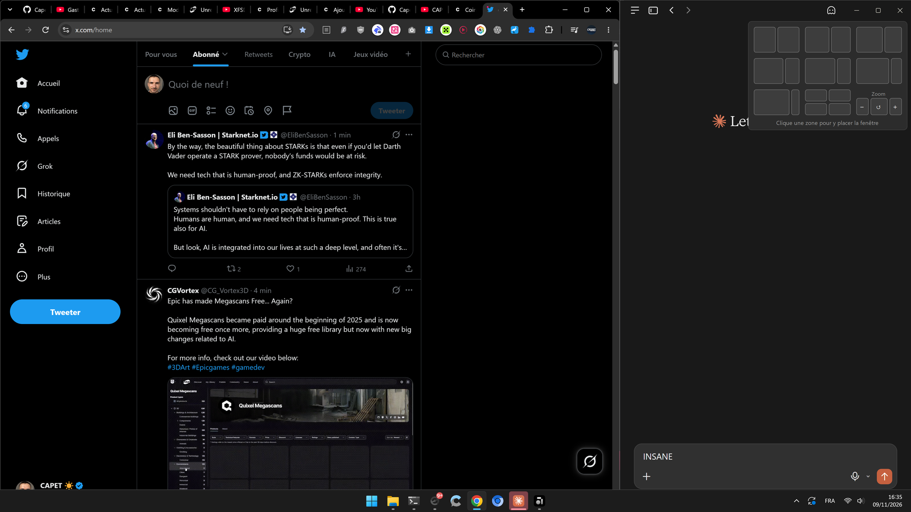
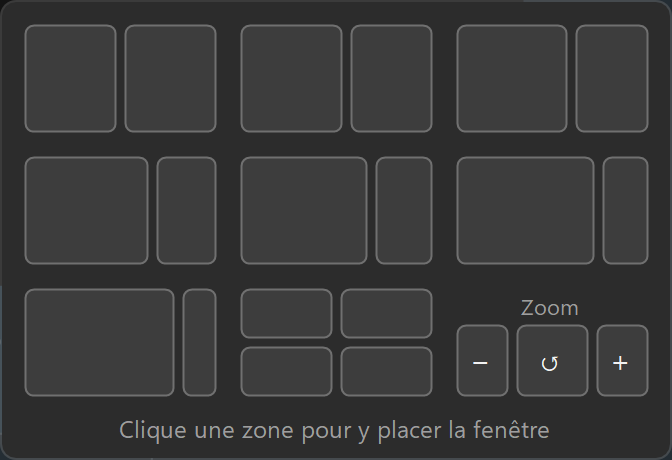

# CustomFancyZone

**English** · [Français](README.fr.md)

Your own snap layouts on Windows 11. Hover the **Maximize** button (□) of any window and pick a zone, just like
the built-in Snap Layouts menu, but with the layouts **you** want: 55/45, 60/40, 74/26, anything.



<p align="center"></p>

## Features

- **Custom layouts on hover.** The menu opens under the Maximize button after 0.4 s, like Windows does.
- **8 layouts out of the box:** 50/50, 55/45, 60/40, 2/3 + 1/3, 68/32, 74/26, 80/20 and four quarters.
  Change them in a small `layouts.json` file, reloaded as soon as you save it.
- **Snap Assist, like Windows.** After placing a window, the empty zones show live thumbnails of your other
  windows: one click fills each zone.
- **No more cropped windows.** Some apps can't shrink below a minimum width (Claude, Discord…). Instead of
  overflowing the screen, they're pushed back against the edge and the neighbouring window takes the rest.
- **Zoom controls** (− · ↺ · +) right in the menu, plus optional automatic zoom per zone.
- **Works with custom title bars:** Chrome, Edge, Electron apps, Windows 11 Notepad, and Unreal Engine.
- Live preview of the zone on screen, light/dark theme and accent colour, multiple monitors with different
  scaling.
- No driver, no service, no admin rights, 0 % CPU when idle.

> The interface is currently in French.

## Install

Windows 10 (1809+) or Windows 11, 64-bit. Nothing else to install, .NET is included.

👉 **[Download the latest release](https://github.com/Capetlevrai/windows-custom-snap-layout/releases/latest)**

| File | What it is |
|---|---|
| `CustomFancyZone-Setup-x.y.z.exe` | **Recommended.** Per-user installer, no admin rights. Adds a Start menu shortcut and an optional "start with Windows". Uninstall from *Settings > Apps*. |
| `CustomFancyZone.exe` | Portable version: put it anywhere and run it. `layouts.json` is created next to it. |

The executables aren't signed, so Windows SmartScreen may say "Windows protected your PC":
click *More info > Run anyway*.

## Quick start

1. **Run CustomFancyZone.** An icon appears in the notification area (next to the clock, maybe behind the ^ arrow).
2. **Turn off the Windows menu**, otherwise both menus show up on top of each other:
   *Settings > System > Multitasking > Snap windows* (expand it), then untick
   "Show snap layouts when I hover over a window's maximize button". The app reminds you on start-up; clicking
   the notification opens the right page.
3. **Hover** the Maximize button of a window for 0.4 s and **click a zone**.
4. **Pick** the window that goes next to it in the empty zone (or press Esc).

## Using it

| Action | Result |
|---|---|
| Hover □ for 0.4 s | Opens the menu below the button (above it if there's no room). |
| Hover a zone | The zone lights up, a translucent rectangle shows where the window will go, the layout name appears at the bottom. |
| Click a zone | The window fills that zone (a maximized window is restored first). |
| Snap Assist | Each remaining zone shows thumbnails of your other windows, most recent first. Click one to place it, Esc or a click elsewhere to stop. |
| Zoom − · ↺ · + | Sends Ctrl − / Ctrl 0 / Ctrl + to the hovered window. The menu stays open so you can click several times. |
| Click □ itself | Maximizes as usual and closes the menu. |

Right-click the tray icon for: edit layouts, open folder, reload, the state of the Windows menu, start with
Windows, pause and quit.

## Customizing

Everything lives in `layouts.json`, next to the executable (`%LOCALAPPDATA%\Programs\CustomFancyZone\` when
installed; the tray icon menu opens it). Comments (`//`) are allowed. Errors are shown in a notification and the
previous configuration stays active. Delete the file to get the defaults back.

### Layouts

A layout is either a **`grid`** drawn with letters (one letter = one zone, all columns the same width,
`.` = empty cell) or a list of **`zones`** as `[x, y, width, height]` in % of the screen (without the taskbar).

```jsonc
{ "name": "50 / 50",        "grid": ["AB"] }
{ "name": "2/3 | 1/3",      "grid": ["AAB"] }
{ "name": "Four quarters",  "grid": ["AB", "CD"] }
{ "name": "Half + stacked", "grid": ["AB", "AC"] }                      // A spans both rows
{ "name": "55 / 45",        "zones": [[0, 0, 55, 100], [55, 0, 45, 100]] }
{ "name": "Centered",       "zones": [[20, 5, 60, 90]] }
```

Zones are numbered in reading order of the letters (`grid`) or in list order (`zones`); Snap Assist fills them
in that order.

Optional **`zoom`** gives a zoom level in % for the window placed in each zone (`null` = leave it):

```jsonc
{ "name": "74 / 26", "zones": [[0, 0, 74, 100], [74, 0, 26, 100]], "zoom": [null, 80] }
```

### Options

| Option | Default | Meaning |
|---|---|---|
| `hoverDelayMs` | `400` | Hover time on the button before the menu opens (ms). |
| `hideDelayMs` | `350` | Delay before the menu closes once the mouse leaves it (ms). |
| `columns` | `3` | Thumbnails per row. |
| `tileWidth` | `96` | Thumbnail width in pixels at 100 % scaling. |
| `zoneGap` | `0` | Gap between and around placed windows (pixels at 100 %). |
| `showPreview` | `true` | Translucent preview of the hovered zone. |
| `showNames` | `true` | Layout name at the bottom of the menu. |
| `snapAssist` | `true` | Offer the other windows to fill the empty zones. |
| `showZoomBar` | `true` | Zoom tile after the last layout. |
| `customButtons` | Unreal | Apps that draw their Maximize button without telling Windows: window class and button position (pixels at 100 % from the top-right corner). |
| `debugLog` | `false` | Detailed log in `CustomFancyZone.log`. |

## How it works

- **Finding the button.** Windows decides whether to show its own menu by asking the window what is under the
  mouse (`WM_NCHITTEST`); the answer `HTMAXBUTTON` means "Maximize button". CustomFancyZone asks the very same
  question every 40 ms when the mouse is near the top of a window, so it works wherever the Windows menu works,
  including custom title bars. Apps that don't answer it (Unreal Engine) are described in `customButtons`.
- **The menu** never takes the focus (`WS_EX_NOACTIVATE`): the window you're placing stays active.
- **Placement** compensates for the invisible resize borders of Windows 11 (`DWMWA_EXTENDED_FRAME_BOUNDS`) and
  handles monitors with different scaling. If a window refuses to shrink, it is pushed back inside the screen
  and its neighbours are shrunk instead.
- **Snap Assist** lists windows the way Alt+Tab does and shows live thumbnails through the DWM thumbnail API.
- **Zoom** sends the app's own shortcuts. The app's real zoom level can't be read, so ↺ means "back to 100 %",
  and a target level is reached from 100 % in Chrome-style steps (67, 75, 80, 90, 100, 110…). Keys are only sent
  once the target window really has the focus.

## Limitations

- Windows running **as administrator** can't be detected or moved unless CustomFancyZone also runs as administrator.
- Apps with **no window buttons at all** (e.g. Discord clients using a Discord-style title bar) offer nothing to
  hover. Switching them to the native title bar fixes it.
- Windows only applies its own "snap layouts on hover" setting live through the Settings app, so it has to be
  unticked by hand once.
- No snap groups, no keyboard navigation in Snap Assist.
- The interface is in French.

## Troubleshooting

| Problem | Try |
|---|---|
| Nothing opens | Is the tray icon there, is the app paused? `CustomFancyZone.exe --hittest X Y` on the button should answer `hit 9`. |
| Two menus on top of each other | The Windows menu is still enabled (Quick start, step 2). |
| A `layouts.json` change does nothing | A notification should explain why; otherwise run `--check`. |
| Anything odd | Set `"debugLog": true` and read `CustomFancyZone.log`. |

<details>
<summary>Command line (diagnostics)</summary>

Add `| Out-String` in PowerShell to see the output (it's a windowed app).

| Command | Does |
|---|---|
| `--check` | Validates `layouts.json` and lists the layouts. |
| `--hittest X Y` | What Windows finds under a screen point (physical pixels). |
| `--place HWND LAYOUT ZONE` | Places a window without the menu (0-based indices). |
| `--assist HWND LAYOUT ZONE [HWND…]` | Places a window then starts Snap Assist (optionally limited to the given windows). |
| `--zoom HWND +\|-\|0\|PERCENT` | Zooms a window. |
| `--demo [SECONDS] [LAYOUT ZONE]` | Shows the menu in the middle of the screen. |
| `--quit` | Closes the running instance. |

</details>

## Uninstall

- **Installer version:** *Settings > Apps > Installed apps > CustomFancyZone > Uninstall*. The app is closed,
  its start-up entry and its folder are removed.
- **Portable version:** tray icon > untick "start with Windows", quit, then delete the exe and `layouts.json`.

Then tick the Windows option again (*Settings > System > Multitasking > Snap windows*) to get the Windows menu back.

## Building

Requires the **.NET 10 SDK**, and **Inno Setup 6** for the installer (`winget install JRSoftware.InnoSetup`).

```powershell
.\build.ps1        # development build in app\ (uses the installed .NET runtime)
.\build.ps1 -Run   # same, then start it
.\release.ps1      # self-contained exe + installer in dist\
```

| Path | Content |
|---|---|
| `src\` | C# source (.NET 10, WinForms): `TrayApp` (hover detection), `FlyoutForm` (menu), `SnapAssistForm`, `PlacementSession` (minimum sizes), `Zoom`, `Config`… |
| `src\layouts.default.json` | Default layouts, embedded in the exe. |
| `installer\` | Inno Setup script. |
| `tools\make-icon.ps1` | Generates `src\app.ico`. |
| `docs\` | Screenshots. |
